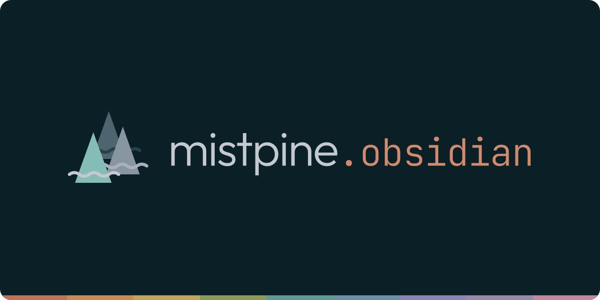
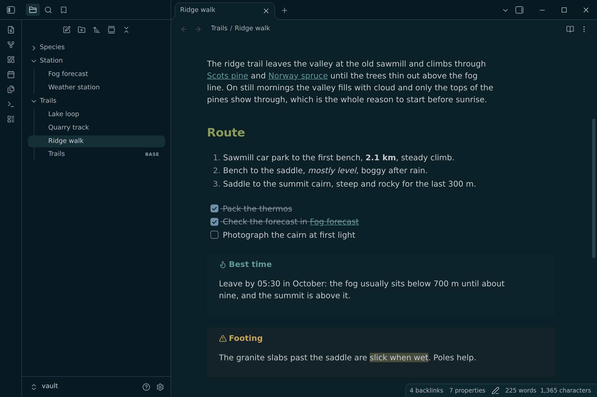
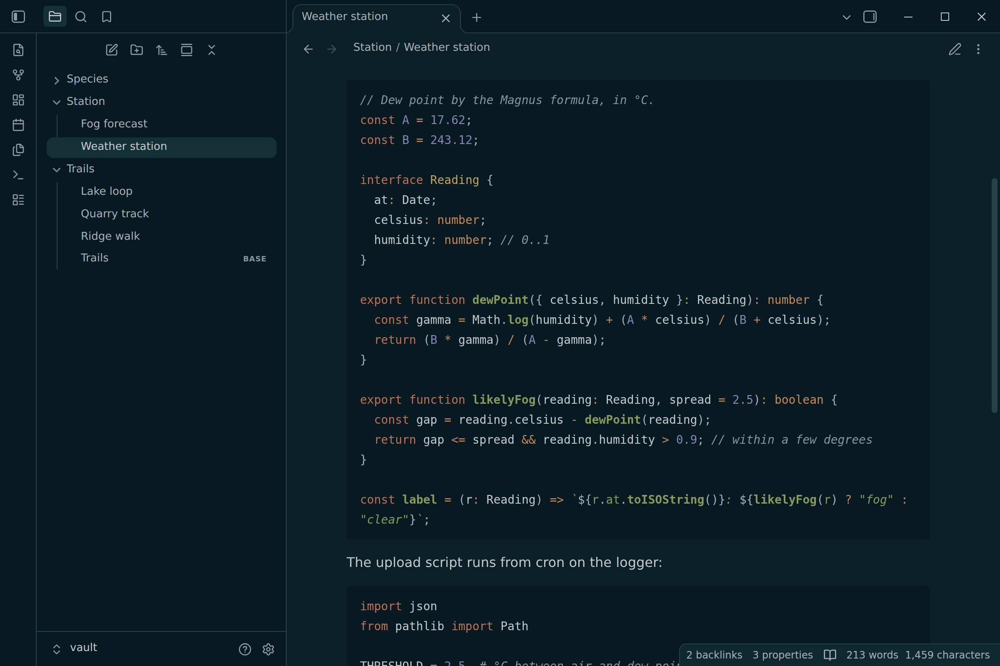
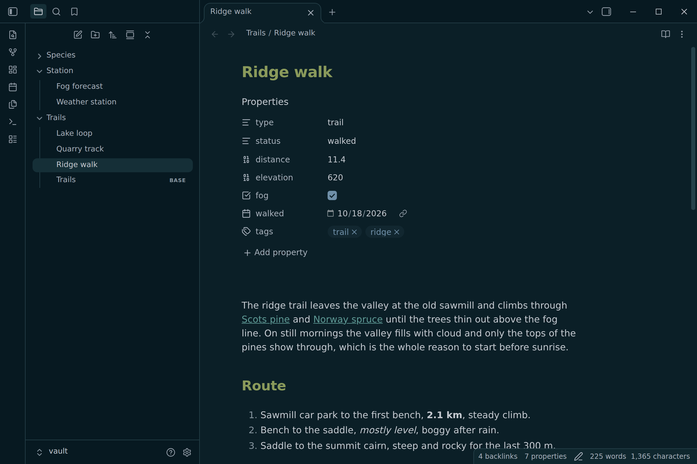
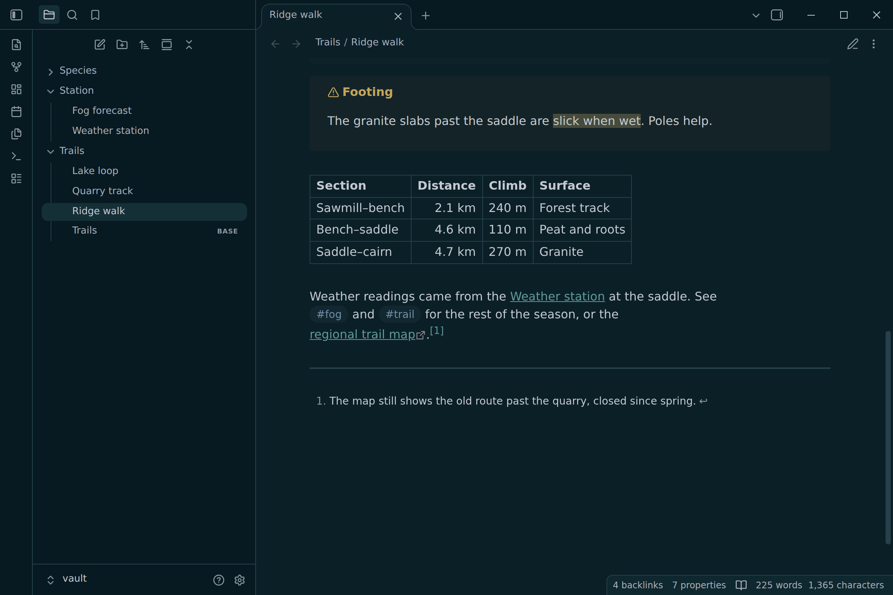
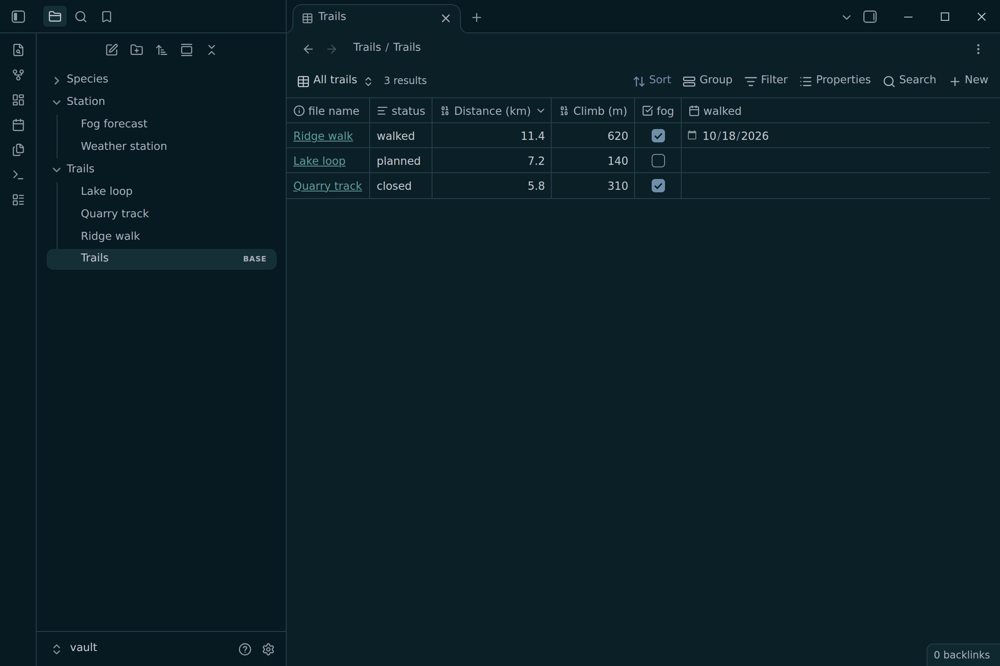
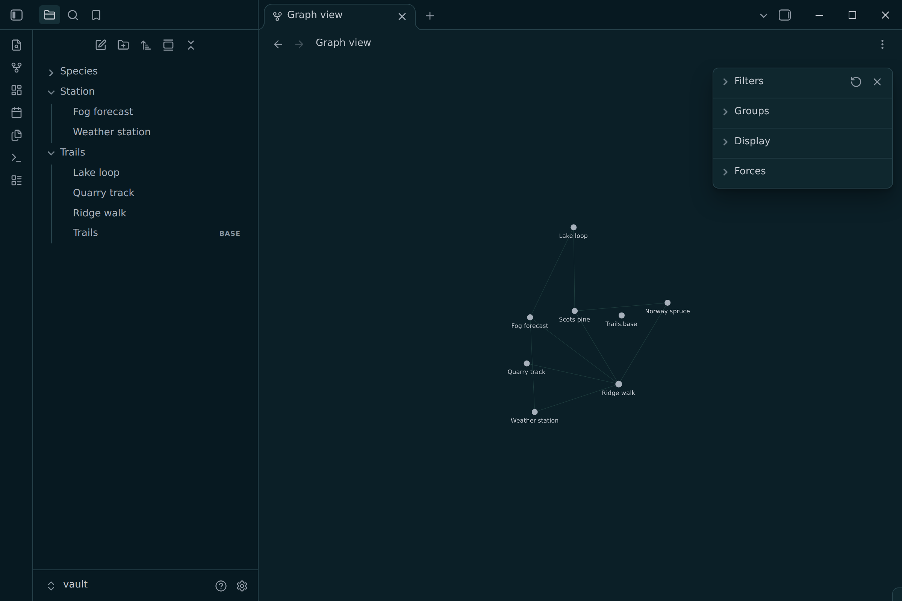
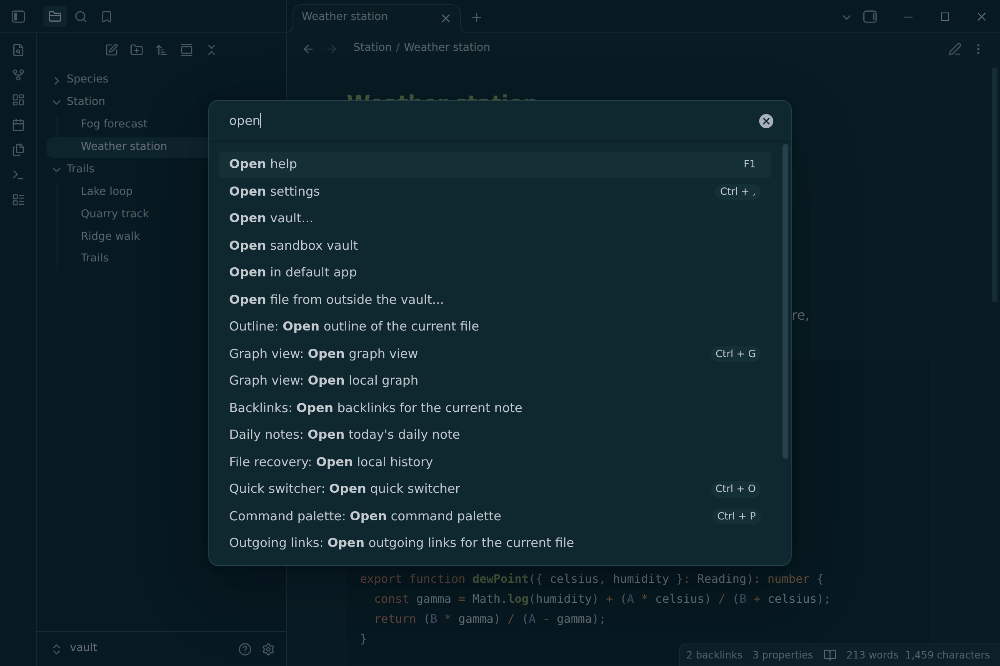

<p align="center">
  
</p>

<p align="center">
  
</p>

**mistpine** for Obsidian: cool, misty grays over a deep blue-green night, with
muted, earthy accents. It is the Obsidian port of
[mistpine](https://github.com/mistpine/mistpine) and follows the
[mistpine spec](https://github.com/mistpine/mistpine/blob/main/docs/spec.md):
every color is a palette color or one of the spec's blends, and every syntax
color, callout title and tag clears 4.5:1 on the surface it sits on.

- Dark only: in light mode Obsidian keeps its default colors
- Sidebars, code blocks and callouts step down to the darkest surface; menus
  and the status bar step up
- Code highlighting by the spec in Reading view: bold functions, italic strings
  and comments, yellow types, orange builtins and operators
- Styled with Obsidian's CSS variables, so properties, Bases, canvas, graph,
  callouts and core plugins follow along
- Your accent color setting still applies
- No fonts, no network requests, no `!important`

## Install

In Obsidian, open **Settings → Appearance → Themes → Manage**, search for
**mistpine**, then **Install and use**.

To install by hand, download `theme.css` and `manifest.json` from the
[latest release](https://github.com/mistpine/mistpine.obsidian/releases/latest)
into `<vault>/.obsidian/themes/mistpine/`, then pick **mistpine** under
**Settings → Appearance → Themes**.

## Customize

Override any variable in a [CSS snippet](https://help.obsidian.md/snippets).
The theme's own variables cover the code colors Obsidian has none for:

```css
.theme-dark {
  --mistpine-code-type: #c2a55b; /* also: builtin, parameter, attribute, */
  --mistpine-code-regex: #5f9a96; /* namespace, macro, link, inserted, deleted */
  --code-background: #0f272e; /* raise code blocks to bg2 */
}
```

In Live Preview, code blocks use CodeMirror's highlighter, which marks every
definition the same way. There, function names, constants and parameters
share the variable color; Reading view tells them apart.

## Screenshots

| | |
| :-: | :-: |
|  |  |
|  |  |
|  |  |

## Development

Requires Node 24+ and pnpm (`corepack enable`).

```sh
pnpm install
pnpm generate  # theme.css from src/theme.css and the mistpine spec
pnpm check     # fail if theme.css is out of date
pnpm banner    # assets/banner.svg and the social preview (Chromium)
pnpm render    # screenshots from the real app: OBSIDIAN=/path/to/obsidian
pnpm lint && pnpm typecheck
```

Edit `src/theme.css`, never `theme.css`. Its `{{bg1}}`, `{{syntax.comment}}` or
`{{mix:bg1:blue:15}}` tokens are filled in from
[`palette/mistpine.json`](https://github.com/mistpine/mistpine/blob/main/palette/mistpine.json)
(read from `$MISTPINE_DIR`, `../mistpine` or GitHub), so color changes happen
upstream. The screenshots come from Obsidian itself, running headless on the
sample vault in `scripts/render/vault`.

To release, bump `version` in `manifest.json`, commit, then push a tag with the
same version (`git tag -a 1.0.1 -m 1.0.1 && git push --tags`). The release
workflow attaches `theme.css` and `manifest.json`, which is where Obsidian
installs from.

## Credits

- Designed in [themes.utimura.io](https://themes.utimura.io).
- [Outfit](https://github.com/Outfitio/Outfit-Fonts) and
  [JetBrains Mono](https://github.com/JetBrains/JetBrainsMono) in the banner.

## License

[MIT](LICENSE). Outfit and JetBrains Mono (in `scripts/fonts`, for the banner) are under the
SIL Open Font License 1.1.
