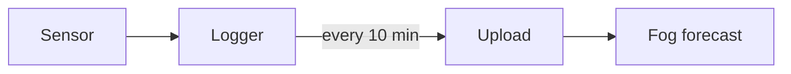

A small logger at the saddle on the [[Ridge walk]]. It reads temperature,
humidity and dew point every ten minutes and flags likely fog.

```ts
// Dew point by the Magnus formula, in °C.
const A = 17.62;
const B = 243.12;

interface Reading {
  at: Date;
  celsius: number;
  humidity: number; // 0..1
}

export function dewPoint({ celsius, humidity }: Reading): number {
  const gamma = Math.log(humidity) + (A * celsius) / (B + celsius);
  return (B * gamma) / (A - gamma);
}

export function likelyFog(reading: Reading, spread = 2.5): boolean {
  const gap = reading.celsius - dewPoint(reading);
  return gap <= spread && reading.humidity > 0.9; // within a few degrees
}

const label = (r: Reading) => `${r.at.toISOString()}: ${likelyFog(r) ? "fog" : "clear"}`;
```

The upload script runs from cron on the logger:

```python
import json
from pathlib import Path

THRESHOLD = 2.5  # °C between air and dew point


def summarize(path: Path) -> dict[str, float]:
    """Average the night's readings and count foggy ones."""
    rows = [json.loads(line) for line in path.read_text().splitlines()]
    foggy = sum(1 for r in rows if r["celsius"] - r["dew"] <= THRESHOLD)
    return {"readings": len(rows), "foggy": foggy, "share": foggy / max(len(rows), 1)}
```



See [[Fog forecast]] for how the readings are used.
